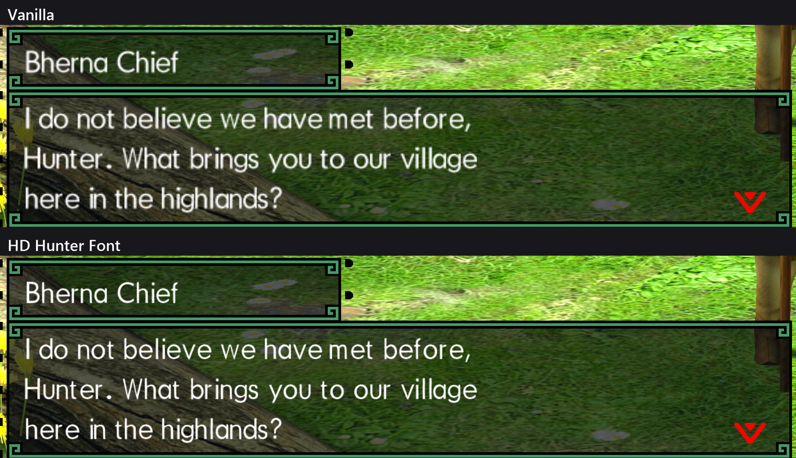

# HD Hunter Font

Sharp, high-resolution in-game text for **Monster Hunter Generations Ultimate** on MHGU Recomp.

At 1440p and 4K the game stretches its Switch-sized font, so menus and dialogue look soft and pixelly. HD Hunter Font replaces it with a 2× version: same typeface, same layout, crisp edges.

*In game at 3840×2160, shown pixel for pixel.*

## Install

1. Download `hd-hunter-font-v1.0.0.zip` from [Releases](https://github.com/lick-mee/mhgu-hd-hunter-font/releases).
2. Extract the `zz-hd-hunter-font` folder into the recomp's `mods` folder.
3. Double-click `install.bat` inside it, once.
4. Start the game.

`install.bat` puts the font into your own copy of the game's `resident.arc`. If you use the **HD texture mod**, it builds on the HD mod's copy, so both work together. **Run it again whenever you update the HD mod.**

To uninstall, delete the `zz-hd-hunter-font` folder.

**Emulators (Yuzu / Ryujinx and forks):** use the same folder as a mod for MHGU, inside that game's mod folder, and run `install.bat`. If it can't find an HD mod next to it, it asks for the path to your `resident.arc` (`romfs\nativeNX\loc\arc\resident.arc` in your dump). This is untested on emulators.

## Notes

- **No extra video memory:** the 2× font pages are compressed (BC3) to the same size as the originals.
- **Languages:** English text is covered. The font pages themselves are shared by all languages.
- **Unchanged text:** text drawn into images (logos, banners) uses other fonts and isn't affected.
- **What the zip contains:** only the font files. The game's archive isn't redistributed; the installer patches yours.

`tools/` has the scripts used to make the font (Python 3 + numpy).

## License

MIT for the code. Monster Hunter Generations Ultimate © CAPCOM.
