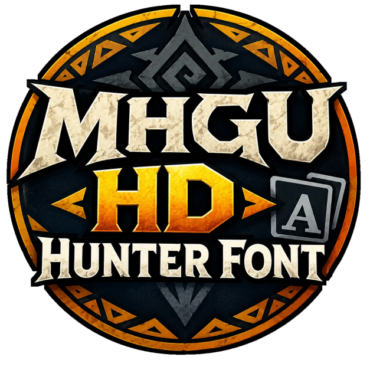

  

  Sharp, high-resolution in-game text for <b>Monster Hunter Generations Ultimate</b> on MHGU Recomp.

  <a href="https://github.com/lick-mee/mhgu-hd-hunter-font/releases/latest"><b>Download the latest release</b></a>

At 1440p and 4K the game stretches its Switch-sized font, so menus and dialogue look soft and pixelly. HD Hunter Font replaces it with a 2× version: same typeface, same layout, crisp edges.

*In game at 3840×2160, shown pixel for pixel.*

## Install

1. Download `hd-hunter-font-v1.0.0.zip` from [Releases](https://github.com/lick-mee/mhgu-hd-hunter-font/releases).
2. Extract the `zz-hd-hunter-font` folder into the recomp's `mods` folder.
3. Double-click `install.bat` inside it, once.
4. Start the game.

`install.bat` puts the font into your own copy of the game's `resident.arc`. If another mod in `mods` replaces that file (HD texture and UI mods do), it builds on that mod's copy, so both keep working. You don't need to pick anything.

To uninstall, delete the `zz-hd-hunter-font` folder.

## Compatibility

Works with any of these as-is, with `install.bat` run once:

| Setup | Tested |
|---|---|
| No other mods (vanilla game files) | ✅ |
| [MHGU HD Project](https://github.com/Monkbreh/MHGU-HD-Project) | ✅ |
| [Pixel Pack v4](https://www.reddit.com/r/MonsterHunter/comments/1icfs4z/mhgu_hd_texture_mod_60_fps_and_multiplayer_2025/) (HD Textures v4 + HD UI v4) | ✅ |

Two things to know:

- **Update your HD mod? Run `install.bat` again.** The font is built into a copy of that mod's `resident.arc`. Until you re-run it, the old copy stays in use and hides the update's changes to that file.
- **Only one mod's `resident.arc` can win.** If you have two mods that both replace it, the installer uses the first one alphabetically. Keep just one of them installed.

The `zz-` folder name makes the font load after the HD mods, which it needs to.

**Emulators (Yuzu / Ryujinx and forks):** use the same folder as a mod for MHGU, inside that game's mod folder, and run `install.bat`. If it can't find an HD mod next to it, it asks for the path to your `resident.arc` (`romfs\nativeNX\loc\arc\resident.arc` in your dump). Not tested on emulators yet.

## Notes

- **No extra video memory:** the 2× font pages are compressed (BC3) to the same size as the originals.
- **Languages:** English text is covered. The font pages themselves are shared by all languages.
- **Unchanged text:** text drawn into images (logos, banners) uses other fonts and isn't affected.
- **What the zip contains:** only the font files. The game's archive isn't redistributed; the installer patches yours.

`tools/` has the scripts used to make the font (Python 3 + numpy).

## Thanks

HD texture mods: [MHGU HD Project](https://github.com/Monkbreh/MHGU-HD-Project) and Pixel Pack.

## License

MIT for the code. Monster Hunter Generations Ultimate © CAPCOM.
